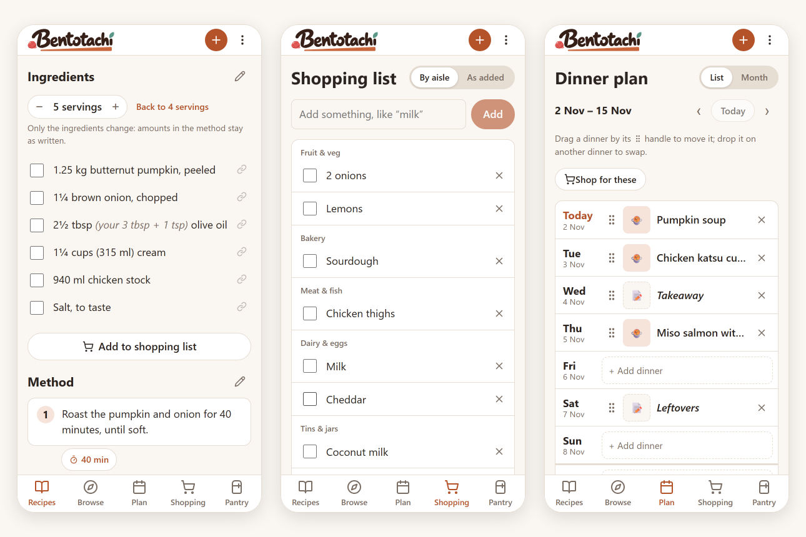

# Bentotachi

A recipe box, meal plan, shopping list and pantry for your household,
starring an onigiri who is fine, actually. Free, private, and kept on your
own phone (or a little server at home, to share it with the people you live
with). Website: **[thekoipond.dev/bentotachi](https://thekoipond.dev/bentotachi/)**



## What it does

- **Save recipes from anywhere**: paste a link or share one from your
  browser, and Bentotachi keeps the recipe without the blogger's life story.
  Or bring a whole collection from Paprika, Mealie or Tandoor.
- **Cook with it**: scale a recipe up or down, tap a step's time to start a
  timer, tick things off as you go, and see hints in your own units (grams,
  cups, your size of tablespoon).
- **Plan meals**: dinners by default, breakfast and lunch if you want them,
  and "didn't we just have that?" answered from what you've cooked.
- **Shop together**: one live list for the household, sorted by aisle, that
  works in the supermarket's no-signal corner.
- **Know your pantry**: scan barcodes, see what's running low, and send it to
  the list.
- **Yours to keep**: no accounts with a company, no ads, no tracking.
  Export everything as a Paprika file whenever you like.

## Getting it

Bentotachi is a small household project, being tested by friends. It's an
Android app that works on its own on your phone; it isn't on Google Play yet.
Households that want to share it run the server below on a computer at home
(a Raspberry Pi or an old PC is plenty), and any phone or computer can then
use it in a browser too.

---

The rest of this is for running and working on Bentotachi. ("Bento" for
short: it's the name inside the code, like the app ID `com.xel.bento`, which
stays so installed phones keep getting updates.)

- `server/` is the backend: [PocketBase](https://pocketbase.io), a single
  program with a built-in database, logins and live updates.
  - `pb_migrations/` sets up the database tables.
  - `pb_hooks/` holds custom server code (the link importer, and rules).
- `web/` is the app people use (React), built into `server/pb_public/`, and
  `web/android/` wraps it into the Android app.
- `mobile/` is the small server the app runs on the phone in phone-only mode.
- `site/` is the website, published to thekoipond.dev/bentotachi on push.
- `docs/PLAN.md` is the roadmap, `docs/REVIEW.md` the list of gaps.

## First-time setup on Windows

Run these in PowerShell, one block at a time.

1. Download PocketBase into the `server` folder:

   ```powershell
   cd C:\Projects\TheKoiPond\bentotachi\server
   Invoke-WebRequest https://github.com/pocketbase/pocketbase/releases/download/v0.40.6/pocketbase_0.40.6_windows_amd64.zip -OutFile pocketbase.zip
   Expand-Archive pocketbase.zip -DestinationPath . -Force
   Remove-Item pocketbase.zip
   ```

2. Make your admin account (for the admin dashboard, not the app). Use your
   own email and a strong password:

   ```powershell
   .\pocketbase.exe superuser upsert you@example.com "a-long-password"
   ```

3. Build the app and start the server:

   ```powershell
   cd C:\Projects\TheKoiPond\bentotachi\web
   npm install
   npm run build
   cd ..\server
   .\pocketbase.exe serve
   ```

   Leave this window open; closing it stops the server.

4. Make an account for each person: open <http://127.0.0.1:8090/_/>, log in
   with the admin account, open **users**, click **New record**, and fill in
   a username (lowercase, like `sam`), password and name. Email is
   optional. To reset a forgotten password, edit the person's record there.

5. Open the app at <http://127.0.0.1:8090> and log in.

## Where it runs: the Raspberry Pi

Our household runs Bentotachi on a Raspberry Pi, as a service: it starts by
itself when the Pi turns on and restarts if it crashes. Its address, from
anywhere with Tailscale on, is the Pi's Tailscale address plus `:8090`
(like `100.64.12.34:8090`).

- The Pi's details live in `web/scripts/pi.json`, which is never committed:
  copy `web/scripts/pi.example.json` to `pi.json` and fill in the Pi's
  login (`user@address`), the server's address on it, and the SSH key.
- On the Pi it lives in `~/bento/server`, the same layout as `server/`
  here, with the real data in `~/bento/server/pb_data`.
- This PC reaches it with an SSH key (ours is `~/.ssh/bento_pi`):
  `ssh -i ~/.ssh/bento_pi user@address`.
- Restart it: `sudo systemctl restart bento` on the Pi (no password needed
  for start, stop, restart and status). Its log:
  `journalctl -u bento -n 50`.
- **Send changes to the Pi**: in `web`, `npm run deploy` builds the app and
  replaces the Pi's `pb_hooks`, `pb_migrations`, `pb_public` and
  `releases`, then restarts it. It never touches the Pi's data. Run it
  after `npm run release` too, or phones won't see the new app. It runs the
  tests first, and won't send anything if a folder is missing here (from a
  fresh clone, `server/releases` is: run a release first, or copy it from
  the Pi).
- **Backups**: the Pi saves one every night at 3:30 am into
  `pb_data/backups` and keeps 7. In `web`, `npm run backup` copies new ones
  to `backups/pi/` here; copy that to a USB stick now and then.
- `server/pb_data` on this PC is the old copy from before the move. Don't
  run the PC server alongside the Pi: changes in one would never reach the
  other. `server/Start Bentotachi here.bat` asks you to type YES first for
  that reason.

## Installing and updating the Android app

- First install on a phone (with Tailscale on): open
  `http://<server address>/api/cookbook/app/download` in Chrome and install.
- Publishing an update: in `web`, run
  `npm run release -- "What changed"` for a small fix (1.2.0 → 1.2.1),
  `npm run release -- minor "What changed"` for a new feature (→ 1.3.0), or
  `npm run release -- major "What changed"` for something big (→ 2.0.0).
  Installed apps show an **Update** banner the next time they're opened.
  It runs the tests first, and needs `web/android/keystore.properties` (the
  signing key's details) so phones can install the update.

## Sharing it with friends (their own server)

In `web`, run `npm run package`. It makes `share/Bentotachi-<version>.zip`
(about 16 MB) with the server program, the app, the latest Android app from
`server/releases`, `Start Bentotachi.bat` and **HOW TO SET UP
BENTOTACHI.html**, a step-by-step guide (also at `/guide.html` on any
Bentotachi server). It copies only those files and refuses to zip anything
private, so your `pb_data`, backups and signing key never go in.

- Run `npm run release` first if the zip should carry the newest app.
- On a friend's brand-new server, the login screen shows **Set up your
  Bentotachi** to make the first account (and the server's admin login,
  `<username>@bento.local`). After that, members add each other under
  **⋮ → Household**.
- Friends' servers don't get your updates by themselves: send them a new zip
  (the guide's "Update to a new Bentotachi" section keeps their `pb_data`).

## Day-to-day development

- Test server (never on this PC's old data while the Pi is live): `cd server`,
  then, with an empty folder outside the project for its data:
  ```
  .\pocketbase.exe superuser upsert test@example.com testpassword123 --dir <scratch>\pb_data --migrationsDir .\pb_migrations --hooksDir .\pb_hooks
  .\pocketbase.exe serve --http 127.0.0.1:8091 --automigrate=false --dir <scratch>\pb_data --migrationsDir .\pb_migrations --hooksDir .\pb_hooks --publicDir .\pb_public
  ```
  The two Dir flags make it use Bentotachi's database setup and hooks (without
  them it starts empty). `--automigrate=false` stops it writing migration
  files into `pb_migrations` when a setting is changed on it, which would
  then change the real database.
- App with instant reloading: in a second window, `cd web` then `npm run dev`,
  and open <http://localhost:5173>
- Tests: `npm test` in `web` runs them all (what release and deploy run
  first). One suite at a time: from the project folder, `node --test "server/test/*.test.js"`,
  and from `web`, `node --test "test/*.test.ts"`. The `server/test/*.check.mjs`
  files check the server end to end against a test server (see the top of
  `pantry-rules.check.mjs`).
- Type check: `cd web` then `npm run typecheck`

## How it's made

Bentotachi is built by Xel, of The Koi Pond, with AI assistance: most of the
code was written with Claude, and the artwork (Ben, the title, the umeboshi,
Deki) and the Pond Pebbles font started as ChatGPT images, then traced and
refined into the files here. Feedback from the rest of The Koi Pond,
[Deci](https://github.com/Decidetto) and [Chai](https://github.com/cha1latte);
design, decisions and testing are human.

## Licence

Bentotachi is free, and meant to stay that way. It's under the
[PolyForm Noncommercial License 1.0.0](LICENSE): you're welcome to use it,
change it and share it, including your own free versions, but not to sell
it or use it to make money (no paid apps, no ads). The store logos are their
owners' trademarks and aren't covered.
